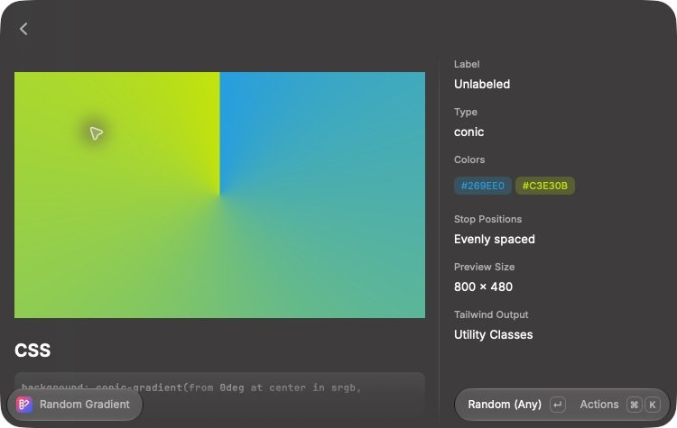

# Gradient Generator

Create, preview and save gradients in Raycast. Copy CSS, Tailwind or SwiftUI code, or export a PNG or SVG file. Everything runs locally.

[Install from the Raycast Store](https://www.raycast.com/smcnab1/gradient-generator) · macOS



## Commands

| Command         | What it does                                                   |
| --------------- | -------------------------------------------------------------- |
| Create Gradient | Build a linear, radial or conic gradient with 2–10 hex colors. |
| Random Gradient | Generate a gradient with two or three random colors.           |
| Saved Gradients | Search, preview, rename, copy or delete saved gradients.       |

## Make your first gradient

1. Open **Create Gradient** and choose Linear, Radial or Conic.
2. Enter your colors as `#RGB` or `#RRGGBB`. For a linear gradient, set the angle too.
3. Add an optional label and choose **Preview Gradient**.
4. Open Actions to copy code, save the gradient or export a file.

For example, try `#FF5733` and `#33C1FF` with a linear angle of `90` for a left-to-right blend. Color stops are evenly spaced; custom positions and per-stop transparency are not supported.

## Copy and export

- **CSS:** linear, radial and conic gradients using sRGB interpolation. Requires a browser that supports CSS gradient color-space syntax.
- **Tailwind:** a `bg-[…]` class, or raw CSS if selected in extension settings.
- **SwiftUI:** a complete `GeneratedGradient` view for macOS 12+ and iOS 15+.
- **PNG:** an opaque image at your chosen size, with 1× or 2× pixel density.
- **SVG:** linear and radial gradients. For conic gradients, use PNG or CSS.

Exports default to `~/Downloads`; change the PNG and SVG folders in extension settings. The folder must exist. PNG output is limited to 8,192 pixels per side and 16,777,216 total pixels, including pixel density. Existing files require confirmation before replacement.

See [saving and export details](docs/usage.md) for labels, file limits and library recovery. Saved gradients stay in local Raycast storage; the extension does not provide cloud sync.

## Development

Use macOS, Raycast, npm and Node.js 26.12.1 or newer (`.nvmrc` selects 26.12.1):

```bash
npm ci --ignore-scripts
npm run check
npm run dev
```

See [development notes](docs/development.md) for source history, additional checks and the existing dependency advisory. The [changelog](CHANGELOG.md), [roadmap](ROADMAP.md) and [release checklist](RELEASE_CHECKLIST.md) track releases and future work.

[Bug reports and feature requests](https://github.com/smcnab1/gradient-generator/issues) and pull requests are welcome.

[MIT licensed](LICENSE).
